```mermaid
flowchart TD
    subgraph Clients ["Multi-Client Ecosystem"]
        Browser["Modern Desktop & Mobile Browsers"]
        PWAApp["PWA Standalone App"]
        WebDavClients["WebDAV Clients (Windows / macOS / rclone)"]
        LegadoApp["Legado Android App (Backup / Progress Sync)"]
    end

    subgraph WebClient ["Web Client (React 19 + TypeScript + Vite)"]
        Nav["AppHeader Navigation (2x2 Locale Grid / Theme Switching)"]
        Reader["ReaderScreen Text Reader (Virtual TOC + Continuous Stream + TTS)"]
        Manga["MangaReaderScreen (Image Stream + Offline Chapters)"]
        Audio["AudiobookPlayerScreen (Range + MediaSession)"]
        Shelf["Multi-Media Bookshelf & Local E-Book Uploader (TXT / EPUB)"]
        Explore["Explore Discovery & Source Search"]
        ScopeBar["SearchScopeBar Scope Tabs (Targeted Scopes)"]
        SourceMgr["SourceGroupManagerModal (Source Group Manager)"]
        WebDavUI["File Manager & Backup Restore Panel"]
        PwaMgr["PwaManager & IndexedDB Local Storage"]
        WSClient["WebSocket Streaming Search Client"]
    end

    subgraph HeadlessServer ["Headless Server (Ktor 3.4 + Kotlin JVM)"]
        Router["Ktor Routing & API Gateway"]
        Auth["PBKDF2 Authentication & CSRF Defense"]
        WebDavEngine["WebDavServer (RFC 4918 Class 1/2)"]
        I18nSvc["I18nMessages Error Localization"]
        
        subgraph CoreServices ["Core Services"]
            LocalParser["LocalBookParser (Charset Detection / Splitting / SVG Covers)"]
            BackupSvc["BackupImporter + CoverBackfill (Restore / Cover Self-Healing)"]
            ProgressSync["BookProgressSync (Book-Kind-Isolated Bidirectional Sync)"]
            TtsSvc["TtsSessionService / EdgeTts / HttpTTS"]
            RuleRunner["RuleRunner (Text / Manga / Audio Rule Execution)"]
            MediaCache["ImageCache + AudioCache + IllustrationCache (Range / GC / Prefetch)"]
            Purify["ContentProcessor Dual Content Purification"]
            CacheSvc["BookCacheService (Text & Illustration Offline Cache)"]
        end
        
        DB[("SQLite Database (WAL Mode + app_setting Roaming)")]
        DiskStorage[("Persistent Storage Volume (/data)")]
    end

    Browser --> Nav
    PWAApp --> Nav
    WebDavClients --> WebDavEngine
    LegadoApp --> WebDavEngine

    Nav --> ScopeBar & Reader & Manga & Audio & Shelf & Explore & SourceMgr & WebDavUI & PwaMgr & WSClient
    WebClient -->|REST API / WebSocket / SSE| Router
    Router --> Auth & I18nSvc
    Auth --> CoreServices
    WebDavEngine --> ProgressSync & DiskStorage
    CoreServices --> DB & DiskStorage
    Manga --> MediaCache
    Audio --> MediaCache
    Reader --> CacheSvc
    MediaCache --> RuleRunner

    RuleRunner -->|HTTP/HTTPS Scrape| WebSources["Internet Book Sources"]
    TtsSvc -->|WSS Voice Synthesis| EdgeCloud["Microsoft Edge TTS Cluster"]
```

<div align="center">


# Legado Server

**Headless Server & Modern Web Client for Legado (开源阅读)**

<p align="center">
  <a href="./README.md">简体中文</a> | <b>English</b>
</p>

[](https://kotlinlang.org/)
[](https://ktor.io/)
[](https://react.dev/)
[](https://www.typescriptlang.org/)
[](https://vitejs.dev/)
[](#-key-features)
[](https://sqlite.org/)
[](https://www.docker.com/)
[](https://computenest.console.aliyun.com/service/instance/create/cn-hangzhou?type=user&ServiceId=service-533806288add4002b02a)
[](https://github.com/lukelzlz/legado-server/actions/workflows/build-jar.yml)
[](LICENSE)

</div>

---

## 📖 Overview

**Legado Server** is a standalone, server-side headless refactoring and modern web client for the popular open-source reading application **[Legado (开源阅读 for Android)](https://github.com/LegadoTeam/legado)**.

Completely decoupled from the Android framework, it provides a high-performance **Headless Server** built on pure **Kotlin JVM + Ktor**, alongside a modern, cross-platform **Web Reader Console** powered by **React 19 + TypeScript + Vite**. Whether on a VPS, home NAS, local container, or cloud-native platform, set up your private reading hub and digital library in seconds.

---

## 📸 Screenshots & UI Preview

<div align="center">

### 📖 Immersive Reader (Multi-column / Infinite Waterfall Stream · Dark & Light Themes)

| Dark Mode | Light Mode |
| :---: | :---: |
|  |  |

### 📚 Modern Bookshelf (Unified Local Books & Web Novels · Progress Sync · Group Management)

| Dark Mode | Light Mode |
| :---: | :---: |
|  |  |

### 🧹 Content Purification Rules (Rule Engine · Regex / @js Sandbox · Real-Time Preview)

| Dark Mode | Light Mode |
| :---: | :---: |
|  |  |

</div>

---

## ⚡ Quick Start (1-Minute Setup)

### 🐳 Option 1: Docker CLI (Recommended)

> [!TIP]
> Minimum password length is 12 characters. Select the appropriate registry based on your network location.

**Global Registry (GitHub Packages GHCR):**
```bash
docker run -d --name legado-server --restart unless-stopped -p 8080:8080 \
  -v ./ls_data:/data -e ADMIN_PASSWORD='your_password_at_least_12_chars' \
  ghcr.io/lukelzlz/legado-server:latest
```

**China Mirror (Alibaba Cloud Container Registry):**
```bash
docker run -d --name legado-server --restart unless-stopped -p 8080:8080 \
  -v ./ls_data:/data -e ADMIN_PASSWORD='your_password_at_least_12_chars' \
  crpi-lup94py5f7l0oclt.cn-beijing.personal.cr.aliyuncs.com/lukelzlz/legado-server:latest
```

Open `http://127.0.0.1:8080` in your browser and sign in with your configured password.

---

### 📦 Option 2: Docker Compose

Create a `docker-compose.yml`:
```yaml
services:
  legado-server:
    image: ghcr.io/lukelzlz/legado-server:latest # In China: crpi-lup94py5f7l0oclt.cn-beijing.personal.cr.aliyuncs.com/lukelzlz/legado-server:latest
    container_name: legado-server
    restart: unless-stopped
    ports:
      - "8080:8080"
    environment:
      ADMIN_PASSWORD: your_password_at_least_12_chars
      LEGADO_SECURE_COOKIES: "false" # Set to false for plaintext HTTP; true for public HTTPS
    volumes:
      - ./ls_data:/data
```
Run `docker compose up -d`.

---

### ☁️ Option 3: One-Click Deploy on Alibaba Cloud Compute Nest

Automatically provision a managed cloud-native instance (Elastic Container Instance ECI + NAS persistent volume + public IP):

[](https://computenest.console.aliyun.com/service/instance/create/cn-hangzhou?type=user&ServiceId=service-533806288add4002b02a)

---

<details>
<summary><b>☕ Expand for additional runtimes (Standalone Fat JAR, Local Development & Password Reset)</b></summary>

#### Standalone Executable Fat JAR (No Docker, requires Java 17+)
```bash
# Download latest legado-server.jar from Releases or Actions
LEGADO_PORT=8080 LEGADO_DATA_DIR=./ls_data ADMIN_PASSWORD='your_password_at_least_12_chars' java -jar legado-server.jar
```

#### Reset Admin Password (if forgotten)
```bash
# Docker container
docker exec -it legado-server /app/bin/legado-server reset-password 'new_password_at_least_12_chars'

# Fat JAR
java -jar legado-server.jar reset-password 'new_password_at_least_12_chars'
```

#### Local Development & Build
```bash
# Frontend (web/)
cd web && npm install && npm run dev

# Backend (root directory)
./gradlew :server:run
```
</details>

---

## ✨ Key Features

| Capability | Highlights & Engineering Principles |
|---|---|
| **🚀 Headless Server & Rule Engine** | Pure Kotlin JVM + Ktor asynchronous stack; sandboxed **Rhino JS + Jsoup + JsonPath** engine compatible with Legado JSON, `@js:`, JS list rules, aggregate sources, and common selector extensions; SQLite WAL persistence. |
| **📖 Immersive Text Reader** | `VirtualChapterList` virtualization for 5,000+ chapters; continuous waterfall reading with measured placeholders and bidirectional preloading; iOS Safari scroll-stability fixes; paginated/continuous layouts, dual-column reading, themes, TTS, and illustration lightbox. |
| **📚 Multi-Media Bookshelf & Routing** | Books are explicitly classified as **novel / manga / audiobook / local**; search, discovery, details, and source switching preserve `bookKind`, route to the correct reader, and show type badges. |
| **🖼️ Manga Reader** | Deep Legado image-source compatibility: lazy-load HTML, `<js>`/JSON image arrays, per-image request options, `nextContentUrl` multi-page chapters, and `replaceRegex`; server-side anti-hotlink proxy, URL-addressed image cache with content fingerprints, manifests, sliding-window GC, offline chapters, and image-level progress. |
| **🎧 Audiobook Player** | Parses plain URLs, JSON multi-segment tracks, `url,{...}` per-track headers, and HTML `<audio>/<source>`; streaming disk cache, Range serving, independent 20 GiB quota, 70% prefetch, millisecond resume, speed/sleep controls, MediaSession lock-screen controls, and offline playback. |
| **🖼️ Inline Illustrations** | Novel `` markup is safely rebuilt and routed through the server with source cookies/headers and chapter Referer; illustrations use a separate `images/` cache, lazy loading, failure placeholders, lightbox zoom, and offline warm-up. Browsers never connect directly to image hosts. |
| **💾 Browsable Media Cache** | Manga, audio, illustrations, and covers use separate roots; readable book/chapter directories are paired with hash-based lookup so renames do not break reads; per-book/range clearing, magic-validated custom cover uploads, prefetch cancellation, and DB/disk media cleanup are supported. |
| **🌐 Fullstack i18n** | Native support for **Simplified Chinese (`zh-CN`), Traditional Chinese (`zh-TW`), English (`en-US`), and Japanese (`ja-JP`)**; 2×2 header switcher; RFC 4647 `Accept-Language` API error localization; cloud-roaming preferences. |
| **🔄 Mobile Progress Sync** | Compatible with the Legado Android WebDAV `legado/bookProgress/` format; merges by chapter index/position and writes back continuously. Novels keep the original filename, while manga and audiobooks use `_comic` / `_audio` suffixes to prevent same-name cross-media collisions. |
| **🗂️ Source Groups, Discovery & Search** | Dedicated Source Group Manager (stats, rename, unbind-delete, bulk assignment); All/Group/Ungrouped scope tabs; discovery categories, pagination, one-click shelf add, JS list rules, and immediate loading feedback for book details. |
| **📚 Local E-Books & Typography** | Drag and drop `.txt` and `.epub` files onto your shelf; auto charset detection (UTF-8/GB18030), intelligent chapter splitting, vector SVG cover generation, local-book cache immunity, and idempotent reparsing from the retained original file. |
| **📦 Backup Restore & Cover Recovery** | One-click import for Android `backup-*.zip` archives (sources, groups, bookmarks, replace rules, HTTP TTS, book variables, shelf books, and progress); only mobile-only local paths are filtered, while manga and audio books are imported normally. Covers support asynchronous backfill, deep source refresh, and background self-healing. |
| **🗣️ TTS & Custom HTTP Voices** | Edge-TTS continuous streaming, viewport alignment, sentence-relative clock anchoring, trailing-silence watchdogs, and MediaSession; also compatible with Legado `httpTTS.json` for managing, importing/exporting, and testing custom HTTP voices. |
| **🎛️ Book Variables & Narrator Switching** | Edit the per-book `custom` variable from book information; rule scripts can read `book.getVariable()` / `book.variableMap`; audiobook sources can switch narrator/voice IDs, and variables round-trip through backups. |
| **📱 PWA & Offline Media** | Installable as a standalone desktop/mobile app; selectively cache text chapters, manga chapters, or audio chapters into browser storage; offline reading/listening with queued progress sync after reconnect; safe-area notch adaptations. |
| **🧹 Purification & Dual Cache** | First-class Replace Rules dashboard with regex, `@js:`, batch enable/disable, groups, and import/export; novel content uses a **dual-column cache** (`raw_content` and `content`) for idempotent, lossless batch recleaning. |
| **📁 In-Process WebDAV** | Native RFC 4918 Class 1/2 WebDAV endpoint (`/webdav`); direct mounting from Windows Explorer, macOS Finder, rclone, and mobile backup sync; integrated web file manager and progress-directory configuration. |

---

## ⚙️ Core Environment Variables

| Variable | Default | Description |
|---|---|---|
| `LEGADO_PORT` | `8080` | Server listening port (HTTP / WebSocket / WebDAV) |
| `LEGADO_DATA_DIR` | `/data` | Root directory for persistence (database, covers, manga/audio/illustration media, WebDAV volume, and local books) |
| `ADMIN_PASSWORD` | None | Initial admin password (required on first launch, at least 12 characters) |
| `LEGADO_SECURE_COOKIES` | `true` | Cookie `Secure` flag. Keep `true` behind HTTPS; set to `false` for local plaintext HTTP. |
| `LEGADO_MANGA_CACHE_MAX_GB` | `10` | Manga image cache quota in GiB; sliding-window GC protects forward-reading chapters |
| `LEGADO_AUDIO_CACHE_MAX_GB` | `20` | Audiobook cache quota in GiB, maintained independently from manga cache |
| `LEGADO_MAX_GLOBAL_IMAGE_FETCHES` | `6` | Global concurrency limit for manga/illustration fetches |
| `LEGADO_MAX_GLOBAL_AUDIO_FETCHES` | `3` | Global concurrency limit for audio fetches |
| `LEGADO_MANGA_PREFETCH` / `LEGADO_AUDIO_PREFETCH` | `true` | Enable or disable background manga/audio prefetching |
| `LEGADO_MANGA_GC` / `LEGADO_AUDIO_GC` | `true` | Enable or disable automatic manga/audio cache collection |
| `LEGADO_COVER_SELFHEAL` | `true` | Enable background detection, retry, and backoff for missing covers |

---

<details>
<summary><b>🏗️ Expand to view System Architecture Diagram (Mermaid)</b></summary>



</details>

---

<details>
<summary><b>🌐 Expand to view Production Nginx Reverse Proxy Configuration</b></summary>

```nginx
server {
    listen 80;
    server_name reader.example.com;
    return 301 https://$host$request_uri;
}

server {
    listen 443 ssl http2;
    server_name reader.example.com;

    ssl_certificate /path/to/cert.pem;
    ssl_certificate_key /path/to/key.pem;
    client_max_body_size 200M; # Accommodates large EPUB/TXT uploads & backups

    location / {
        proxy_pass http://127.0.0.1:8080;
        proxy_set_header Host $host;
        proxy_set_header X-Real-IP $remote_addr;
        proxy_set_header X-Forwarded-For $proxy_add_x_forwarded_for;
        proxy_set_header X-Forwarded-Proto $scheme;

        # WebSocket Streaming Support
        proxy_http_version 1.1;
        proxy_set_header Upgrade $http_upgrade;
        proxy_set_header Connection "upgrade";
        proxy_read_timeout 300s;
    }

    # Disable proxy buffering for continuous TTS audio streams
    location ~* ^/api/tts/ {
        proxy_pass http://127.0.0.1:8080;
        proxy_buffering off;
        proxy_cache off;
        proxy_read_timeout 600s;
    }

    # WebDAV Endpoint Passthrough
    location /webdav {
        proxy_pass http://127.0.0.1:8080;
        proxy_buffering off;
        proxy_request_buffering off;
        proxy_read_timeout 600s;
    }
}
```

</details>

---

## 🧪 Verification & Testing

```bash
# Frontend static typechecking and automated test suite (377 test cases covering text/manga/audio readers, TTS, offline storage, and i18n)
npm --prefix web run check && npx tsx web/test/run-all.ts

# Server JVM scenario and unit tests
./gradlew :server:test
```

---

## 🤝 Acknowledgements

- **[Legado (开源阅读 for Android)](https://github.com/LegadoTeam/legado)**: Groundbreaking book source protocol design and open-source contribution.
- **[Ktor](https://ktor.io/)**: Flexible, asynchronous, non-blocking Web framework for Kotlin.
- **[React](https://react.dev/) & [Vite](https://vitejs.dev/)**: Modern, performant frontend architecture.
- **[Rhino](https://github.com/mozilla/rhino)** & **[Jsoup](https://jsoup.org/)** & **[Jayway JsonPath](https://github.com/json-path/JsonPath)**: Efficient pure JVM rule execution engines.
- **[Microsoft Edge TTS](https://github.com/rany2/edge-tts)**: High-fidelity neural speech synthesis ecosystem.
- **[reader (hectorqin/reader)](https://github.com/hectorqin/reader)**: Classic open-source Reader server; our Kindle / E-ink minimalist UI (`/simple`) is heavily inspired by its frontend design.

---

## 📄 License

This project is licensed under the **[GPL-3.0 License](LICENSE)**.
