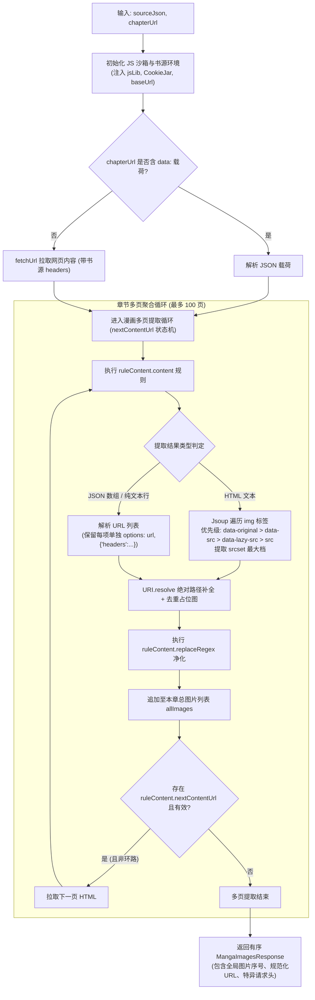

# PROPOSAL-028: 漫画（图片书源）端到端支持与内嵌内容寻址缓存体系 (方案E · 原版规则完全适配)

## 1. 业务背景与问题痛点

`legado-server` 现已支持标准网络小说文本规则解析、大章节目录虚拟化、离线缓存、替换净化及 Edge-TTS 朗读流。然而在网络书源生态中，**漫画/画册类书源**（Legado 规范中定义为 `bookSourceType == 2`）始终处于缺失状态：

1. **正文提取管道强制纯文本清洗**：当前 `RuleRunner.kt` 的正文管道（`content`）在末端会执行 `cleanContent()` 强力剥离 HTML 标签，导致漫画章节页中的 `` 标签被整段删除，用户打开漫画只能看到白屏或提示“正文未提取到内容”。
2. **缺少对 Legado 原版漫画规则全形态的适配**：
   - 原版漫画源在 `ruleContent` 中有多种独特的规则形态：不仅有 HTML `` 标签，还有 `<js>` 直接返回 URL 数组、纯文本换行/逗号分隔清单、带自定义 header 参数的 URL 选项（如 `url,{"headers": {...}}`）、Base64 内联图片、以及依靠 **`nextContentUrl` 章节内多页翻页拼接**的漫画站。目前服务端对此完全缺乏解析与拼接能力。
3. **图床防盗链与鉴权壁垒**：漫画图床通常具有极严格的防盗链机制（校验 `Referer` 必须为源站章节 URL）、需要书源登录 Cookie（CookieJar），部分甚至采用 Gzip 伪装或动态解密。如果前端浏览器直接根据图片 URL 直连，会大面积触发 HTTP 403 Forbidden、防盗链水印或直接裂图。
4. **书架类别识别与阅读器交互割裂**：当前 `ShelfKind.kt` 仅有 `ONLINE`、`LOCAL`、`AUDIO` 分支，漫画类条目在导入备份时被误判为小说或过滤；且当前阅读器仅针对文本分段与排版设计，缺少漫画专属的瀑布流纵向连卷、图片预载、失败重试与图片手势阅读体验。
5. **图片重复存储与离线完整性矛盾**：漫画章节图片体积大（单章 2~20 MB）。若仅按章节目录存储会产生大量重复彩页/广告页存储冗余；若仅按单图离线又缺失“章节原子完整性”，断网阅读容易出现后半截裂图的极差体验。

---

## 2. 目标与非目标 (Goals & Non-Goals)

### 2.1 目标 (Goals)
1. **100% 深度兼容 Legado 原版漫画规则规范 (原版标准对齐)**：
   - **书源类型识别**：精准识别 `source.payload.bookSourceType == 2`（以及书架 `type` 包含对应位掩码 / `tab == "漫画"`）。
   - **原版 `ruleContent.content` 全形态提取**：
     - **形态 1（HTML ``）**：全属性智能提取，优先级匹配 `data-original` → `data-src` → `data-lazy-src` → `data-actualsrc` → `src`。
     - **形态 2（`srcset` 多分辨率）**：自动提取最高分辨率档位图片。
     - **形态 3（纯文本换行/逗号列表）**：提取每一行非空有效图片链接。
     - **形态 4（JS / JsonPath 数组直出）**：完整支持 `<js>` / `@js:` 返回 JSON 数组（`["url1", "url2"]` 或 `[{url: "..."}]`），杜绝 Java Map `toString()` 序列化坏数据。
     - **形态 5（URL 自定义 Options）**：完全支持原版 Legado 的 `url,{"headers": {...}}` 扩展语法，提取图片特异性请求头并注入下载请求。
     - **形态 6（内联 Base64 图片）**：兼容 `data:image/...;base64,...` 格式图片直出。
     - **形态 7（相对路径补全）**：以当前章节 URL 为基准，严格通过 `URI.resolve()` 补全绝对路径。
   - **原版 `ruleContent.nextContentUrl` 章节内分页拼接**：
     - 完整实现章节多页合并：针对一页一图/一页多图的漫画源，自动沿 `nextContentUrl` 链式抓取直至最后一页（带环路与最大页数 100 页守卫），合并为单一章节有序图片流。
   - **原版 `ruleContent.replaceRegex` 净化过滤**：
     - 正确执行正文替换规则，过滤广告图、防盗链干扰字符及 1x1 占位透明图。
   - **全量 Rhino JS 沙箱支持**：
     - 漫画源常用的 `@js:` 混淆解密算法（AES解密、字符偏移、Base64拼装）完全复用项目成熟的 Rhino JS 沙箱与兼容垫片。
2. **内嵌式双层缓存架构 (方案 E: L1 + L2)**：
   - **L1 物理字节去重**：服务端带书源请求头（`Referer`、`User-Agent`、`Cookie` 及图片级 options）代理抓取，校验图片魔数与 gzip 兜底解压，基于 `sha256(sourceId + '\n' + 规范化URL)` 内容寻址落盘并执行全局限流与 LRU GC。
   - **L2 章节原子视图**：服务端维护有序 `manifest`（仅引用 L1 的 `cacheKey` 与元数据，不复制物理字节），提供整章就绪状态判定与目录离线绿点（`●`）。
3. **现代漫画 Web 阅读体验**：
   - 前端新增 `MangaReaderScreen.tsx`，支持平滑纵向连续滚动、图片懒加载、骨架屏防抖动、跨章双向无缝衔接及读完预取。
   - 进度记录精确到“章节索引 + 当前图片序号 / 总张数”。

### 2.2 非目标 (Non-Goals)
1. **坚决不引入独立外部服务**：否决外置独立站点（方案 D）或独立子服务（方案 F1/F2），不引入第二套鉴权 Cookie、第二套进度表或第二套书架系统，维持单容器单进程极简部署，恪守 `AGENTS.md` 的复杂度惩罚原则。
2. **不重写规则引擎**：严禁采用 Python 重写规则执行器（否决 F2），全量复用现有的 Rhino JS 沙箱、Jsoup 与 Jsoup 选择器补丁资产。
3. **不强行实施图片转码或重压缩**：服务端只做合规性魔数校验与原样缓存分发，不引入 WebP/AVIF 等高消耗转码管道，避免挤占 CPU 导致文本与 TTS 性能劣化。
4. **暂不涉及漫画弹幕与社交评论**：仅聚焦于核心沉浸式阅读与离线存储。

---

## 3. 核心用户故事 (User Stories)

### Story 1: 复杂原版漫画书源全规则解析与阅读 (P0 · 核心)
- **作为** 一名从 Legado Android 导入漫画书源（包含 JS 解密脚本、懒加载属性、以及带 `nextContentUrl` 分页）的读者，
- **当** 我打开一本漫画章节时，
- **系统应** 完全依照 Legado 原版规则规范，执行 JS 解密、多页自动翻页拼接、提取全部图片并补全相对路径，在前端按严格物理阅读顺序连卷呈现，无任何破图、乱序或分页丢失。

### Story 2: 防盗链图床穿透与二次秒开 (P1)
- **作为** 一名阅读图床有严格防盗链限制（必须携带源站 Referer / Cookie / 特异请求头）的用户，
- **当** 我首次进入章节阅读时，
- **系统应** 由服务端携带书源及图片特异上下文头信息代理拉取并安全落盘（L1 内容寻址）；当我二次进入该章节或换设备阅读时，所有图片由服务端直出，零上游网络请求，毫秒级呈现。

### Story 3: 章节整本离线与断网脱机阅读 (P2/P3)
- **作为** 一名经常在通勤断网场景阅读的用户，
- **当** 我在目录中点击“离线缓存后 20 章”时，
- **系统应** 在后台队列并发有序拉取并写入 L2 manifest 视图，且在目录旁展示离线绿点徽标（`●`）；即使切换到飞行模式，已离线的章节仍可连贯流畅翻页，不出现半截裂图。

### Story 4: 缓存空间自动配额与滑窗 LRU 淘汰 (P2)
- **作为** 一名服务端宿主机存储空间有限的管理员，
- **当** 漫画图片缓存总体积接近配置配额（默认 10 GiB，可由 `LEGADO_MANGA_CACHE_MAX_GB` 调整）时，
- **系统应** 自动触发后台 `ImageCacheGc` 任务，优先清理已经读完且落后于当前进度的早期历史章节，绝不误删我当前在读书籍后方正在等待翻阅的前瞻章节（滑窗保护），且严格保留我手动“整本离线（pinned）”的漫画，保证服务稳定运行且磁盘不被撑爆。

---

## 4. Legado 原版漫画规则适配详设

### 4.1 `RuleRunner.mangaImages()` 解析管道流

### 4.2 原版核心特性适配对照表

| Legado 原版规范特性 | 原版行为 / 约定 | 本项目适配与落地策略 |
| :--- | :--- | :--- |
| **`bookSourceType`** | `2` 表示图片/漫画源 | `source.payload.bookSourceType == 2`，书架 `ShelfKind.COMIC` 独立分支。 |
| **懒加载属性提取** | 各种图床自定义属性 | 按 `data-original` → `data-src` → `data-lazy-src` → `data-actualsrc` → `src` 降级提取。 |
| **`srcset` 响应式** | `img.jpg 1x, img-hd.jpg 2x` | 正则切分取最后一档最大分辨率 URL。 |
| **JS 规则数组输出** | `<js>result.map(...)` 返回 Array | Rhino 沙箱求值后若为 NativeArray/List，逐项安全转为字符串，杜绝 Java `toString()`。 |
| **URL 专属 Options** | `url,{"headers": {"Referer": "..."}}` | 复用 `splitUrlOptions()`，将图片专用 headers 随 `MangaImageRef` 传递给 Fetcher。 |
| **`nextContentUrl`** | 单章多页漫画链式翻页 | 循环拉取下一页，直到 `nextContentUrl` 为空或出现环路，最大页数保护 100 页。 |
| **`replaceRegex`** | 正则净化与过滤 | 对提取出的图片 URL 列表执行正则替换与剔除。 |
| **占位图/广告过滤** | 过滤 1x1 透明 gif / 广告占位 | 过滤短 data URL、常见 1x1 gif 及长宽小于 10 像素的占位图。 |

---

## 5. 分期实施路线 (Phased Roadmap)

| 阶段 | 交付核心 | 后端工作 | 前端工作 | 验证与验收目标 |
| :--- | :--- | :--- | :--- | :--- |
| **P0** (0.5~1d) | **原版规则全量打通** | `RuleRunner.mangaImages()`（含 HTML/JS数组/nextContentUrl/options提取）、`ShelfKind.COMIC` 补充分支、`POST /api/books/images` | `MangaReaderScreen.tsx` 雏形，支持直连阅读 | 真实漫画源（含翻页漫画源）能完整提取全量图片并保序呈现；识别防盗链需求。 |
| **P1** (1~2d) | **服务端代理与L1落盘** | `manga_image_cache` 表、`MangaImageFetcher` 限流代理（带图源 headers 及图片专属 options）、`GET /api/images/{key}` 直出（ETag/Range） | 清单改为使用 `key` 加载，增加首屏占位骨架屏与裂图重试 | 突破防盗链；二次加载零外部网络请求；断网可读已抓取图片。 |
| **P2** (1~2d) | **章节视图与LRU淘汰** | `manifest` 接口、预取接口、后台 `ImageCacheGc`（配额限制 + LRU 淘汰） | 目录已缓存绿色徽标（`●`）、连卷预载、缓存用量查看与清理 | 缓存总容量不超配额；最近章节离线稳定可用；预取无感知。 |
| **P3** (1d) | **PWA离线与细粒度进度** | 进度上报记录图片序列、离线同步状态 | Service Worker 整章 `CacheStorage` 离线支持，阅读进度精准恢复 | 飞行模式翻完已缓存章节无阻碍；重新打开准确定位到具体图片。 |

---

## 6. 验收基准 (Acceptance Criteria)

- [ ] **原版规则全量解析**：针对不同形态的 Legado 漫画源（HTML 懒加载、`<js>` 返回数组、纯文本 URL、带 `nextContentUrl` 多页分页源），`POST /api/books/images` 能准确返回全部图片，顺序完全一致无截断。
- [ ] **URL 专属 Header 穿透**：当图片 URL 带 `,{"headers": {"Referer": "..."}}` 扩展参数时，服务端下载时正确携带该 Header，顺利穿透特殊图床防盗链。
- [ ] **内容寻址去重**：多次抓取相同图片 URL 或不同章节共享的相同图片，盘上仅有一份物理文件，且数据库不产生重复主键。
- [ ] **章节完整性与离线**：断开外网连接后，已完成整章缓存的漫画能够完整阅读，目录正确呈现 `●` 徽标。
- [ ] **配额与 GC**：模拟写入超过配额大小的图片，`ImageCacheGc` 能够按照滑窗模型优先淘汰已读完的历史老旧章节，保护在读后方前瞻章节与置顶漫画。
- [ ] **工程质量**：前端通过 `npm --prefix web run check` 与 `npx tsx web/test/run-all.ts`；后端通过 `./gradlew :server:test`，无任何破坏性回归。
